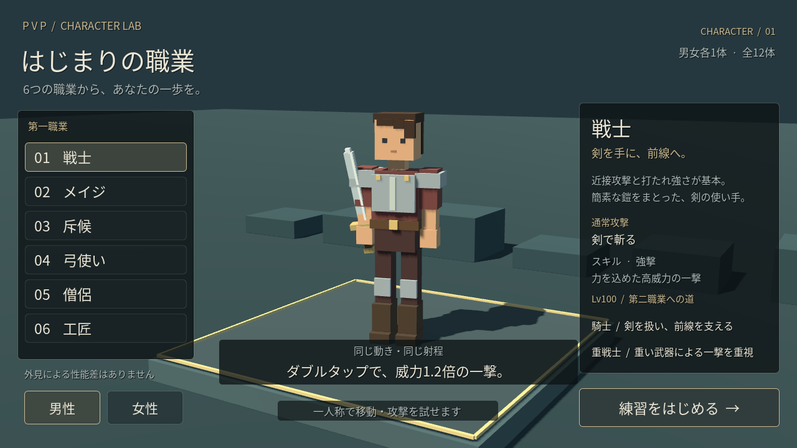
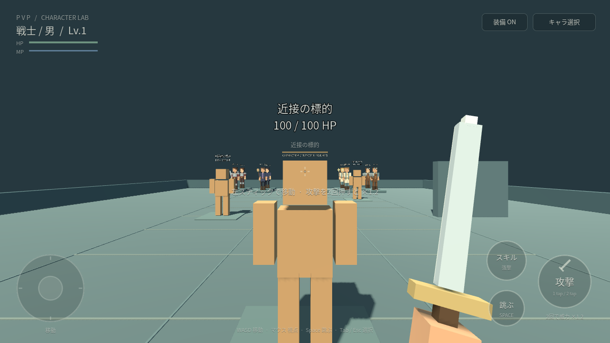

# PVP — キャラクター・戦闘プレイグラウンド

初期6職×男女1体ずつ、計12体のボクセルキャラと、一人称で移動・攻撃できるプレイ画面です。**既存の王都・マップ制作から独立した Godot 4.6.3 プロジェクト**です。外部ライブラリ、購入素材、マップの再生成は不要です。





## 開き方

Godotのプロジェクト一覧から、このフォルダー内の **`character_playground/project.godot`** をインポートし、F5で実行してください。職業と男女を選び「練習をはじめる」でプレイします。親フォルダーの `project.godot` は引き続き王都の見学用です。

```sh
godot --path character_playground --editor
# リポジトリのルートから、直接プレイする場合
godot --path character_playground
```

## キャラクター

| 初期職業 | 見た目 | 通常攻撃 | 初期スキル |
| --- | --- | --- | --- |
| 戦士 | 簡素な鎧・小さな肩当て | 剣で斬る | 強撃 |
| メイジ | 黒い薄手のマント | 杖から小さな火球 | 火炎爆発 |
| 斥候 | 緑の軽装・短剣 | 短剣で突く | 急所突き |
| 弓使い | 革の軽装・矢筒 | 弓から矢 | 貫通矢 |
| 僧侶 | 淡い法衣・聖杖 | 小さな光弾 | ヒール |
| 工匠 | 作業着・前掛け・道具袋 | 工具槌で殴る | 投擲爆弾 |

各職業に男性・女性の2種類。髪形・体の比率は異なりますが、当たり判定・移動速度・攻撃性能は同じです。ブロックを関節ごとに結合し、12体で94メッシュ・6,216三角形。歩行・待機・攻撃用の関節アニメーションを備えています。選択画面には第一職業の説明と、Lv100の第二職業2ルートだけを表示します。

## 操作

| 動作 | PC | タッチ |
| --- | --- | --- |
| 移動 | WASD / 矢印 | 左の丸いスティック |
| 視点・照準 | マウス | 右側の空白をドラッグ |
| 走る | Shift | — |
| ジャンプ | Space | 攻撃の左下「跳ぶ」 |
| 通常攻撃 | 左クリック1回 | 「攻撃」1回 |
| 強い攻撃 | 左ダブルクリック | 「攻撃」2回 |
| スキル選択 | Qを1回 | 「スキル」1回 |
| 選択スキル使用 | Qを2回 | 「スキル」2回 |
| 素手／武器を切替 | E | 右上の「装備 ON／素手」 |
| キャラ選択へ戻る・マウス解除 | Esc / Tab | 右上の「キャラ選択」 |
| 開始位置へ戻る | R | キャラを選び直す |

HUDは暗い色を約16〜30%の不透明度で重ね、細い輪郭と控えめな文字にしています。移動・視点・攻撃・ジャンプを別々の指で操作できます。画面外へ移動したときは保留中のタップとスティックを解除し、キャラ選択へ戻ります。

### 通常攻撃とダブル入力

[ゲーム構想](../README.md)第2・8節に合わせ、ダブル入力は**同じ動作・同じ射程で、威力1.2倍の1発**です。最初の入力を0.25秒だけ保留し、2回目があれば強い1発だけを出します。通常攻撃2発が追加で出ることはありません。通常攻撃には、この判定時間分の待ち時間があります。

武器を外すと全職が素手のパンチになります。職業スキルは武器を装備しているときに使えます。初期職業のスキルは1つなので、スキルの1回タップは選択の確認だけ、2回タップで使用します。装備切り替え・キャラ選択・フォーカス喪失時には、未発動の入力を破棄します。

### 練習で確認できること

3体の練習標的に照準を合わせて攻撃すると、HPが減り、被弾色とダメージ数値が表示されます。倒れた標的は3秒後に復帰します。近接は距離制限があり、火球・光弾・矢は実際に飛んで衝突します。右側の板に向けて撃つと、攻撃が壁で止まることも確認できます。奥には12体の見本を並べています。

スキルは、強撃・急所突きの近接攻撃、火炎爆発・投擲爆弾の範囲攻撃、貫通矢の複数標的への貫通、ヒールの自分のHP回復を試作しています。標的は反撃しません。ヒールはHPが減っているときだけ実際の回復量が生じます。

## 仮の数値と実装範囲

確定しているのは職業ごとの通常攻撃の種類とダブル入力1.2倍です。READMEで未定の威力・射程・MP消費・待ち時間は、`scripts/combat_system.gd` の定数へ**この練習用だけの仮値**としてまとめました。移動速度・0.25秒の入力判定も仮値です。急所突きは確認しやすくするため固定の高威力、ヒールは自分のみを対象にしています。

オンラインPvP、能力値成長、転職、セーフティーエリアやNPC会話はこのプロジェクトの対象外です。実機スマートフォンの性能は未測定です。

## 分離の境界

このプロジェクトは親の `scripts/voxel/`、`scripts/player_controller.gd`、`scripts/hud.gd`、`generated/`、王都シーンを読み込みません。マップの造形・生成・保存済みデータには変更を加えていません。床・標的・展示台は `scripts/main.gd` にある動作確認用の仮設備です。

| ファイル | 責務 |
| --- | --- |
| `scripts/voxel_character.gd` | 12体の造形、関節アニメーション、武器の生成 |
| `scripts/character_select.gd` | キャラ選択・職業の説明 |
| `scripts/play_controller.gd` | 一人称移動、視点、単／ダブル入力の判定、手元武器 |
| `scripts/combat_system.gd` | 攻撃・スキル、弾の移動と衝突、仮のバランス値 |
| `scripts/practice_target.gd` | 標的のHP・被弾・復帰 |
| `scripts/play_hud.gd` | 半透明HUDとマルチタッチ |
| `scripts/main.gd` | 独立した表示・操作・戦闘モジュールの組み立て |

将来マップへ接続するときは、キャラとプレイヤー、HUD、戦闘システムを受け側のシーンで組み立ててください。衝突レイヤー1が環境、2が標的、4がプレイヤー。戦闘システムはカメラと `take_damage(amount)` を持つ対象を参照します。

## 検証とWeb版

リポジトリのルートから実行します。

```sh
godot --headless --path character_playground --fixed-fps 60 --script res://tools/test_playground.gd

godot --headless --path character_playground --export-release Web build/web/index.html
python3 tools/serve_preview.py --directory character_playground/build/web --port 8081

# 別のターミナルでPC・タッチ操作のブラウザ検証
python3 character_playground/tools/browser_smoke.py --url http://127.0.0.1:8081/ --output character_playground/captures
```

Web書き出しにはGodot 4.6.3のWebテンプレートが必要です。親プロジェクトの `tools/download_web_templates.py` で導入できます。`http://127.0.0.1:8081/` で起動し、HTMLを直接ダブルクリックしないでください。

物理・入力テスト130項目を通過しています。物理テスト結果は [headless-results.json](docs/headless-results.json)、ブラウザでのPC・タッチ検証は [web-results.json](docs/web-results.json) を参照してください。ブラウザ検証は描画と操作の確認であり、実機の性能測定ではありません。

フォントはOFLのNoto Sans CJKを表示文字に絞ったものです。[ライセンス](assets/NOTO-LICENSE.txt)。モデル・装備・エフェクトはコードで生成しています。
