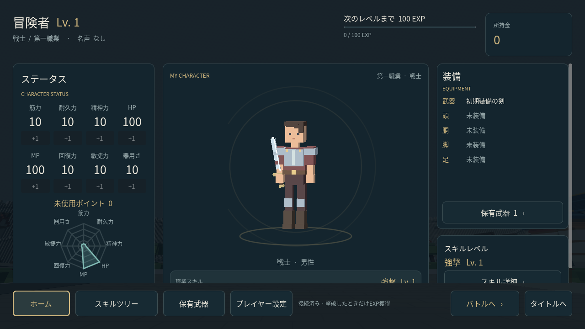
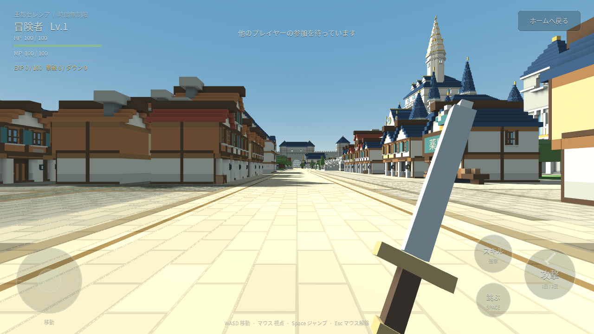

# 王都の時間無制限対戦と成長

更新日：2026-10-28。ホーム・第一6職のキャラクター・王都を接続する対戦試作です。別プロセスで起動したGodotサーバーに、複数のユーザーがWebSocketで参加します。

## 今回の遊び方

ホームから王都へ入り、城内を移動して他ユーザーと戦います。人数待ちで開始する試合や制限時間、縮小する戦闘区域、最後の1人で終了する処理はありません。1人でも参加でき、ほかのユーザーが入るまで街を移動して待てます。

東西南北の4つの門は、対戦中には目に見える鉄格子と衝突判定で閉じます。開始時と倒された後の復帰位置は、門を入った内側です。既存の城壁・王城・城下町の生成済み19成分は変更せず、対戦用の門を実行時に加えます。城外はこれまでどおり更地です。

対戦相手は同じサーバーに参加している他ユーザーです。敵BOTは追加していません。街にある静止した棒人間や独立プレイグラウンドの標的を倒して、EXPを得る仕組みはありません。

## 起動する

Godot 4.6.3と、Web版を配信する場合はPython 3を使います。プロジェクトに追加の有料素材やサービスは必要ありません。

最初に、リポジトリのルートで素材をインポートします。Godotエディターで `project.godot` を開いてインポートしても構いません。

```sh
godot --headless --editor --path . --import
```

別のターミナルで対戦サーバーを起動します。このプロセスは、プレイヤーを受け入れている間は動かしておきます。

```sh
godot --headless --path . --script res://tools/run_battle_server.gd -- --port=8910
```

通常のクライアントは、Godotで **F5**、または次のコマンドで起動します。

```sh
godot --path .
```

**START**でホームへ進み、接続先と初期キャラクターを設定して対戦サーバーに接続します。同じPCで起動したサーバーへの接続先は `ws://127.0.0.1:8910` です。同じLANの別端末は、`127.0.0.1` の代わりにサーバーPCのLANアドレスを使います。

実際の対戦は、別端末か、保存領域が分かれた別ブラウザープロファイルから参加して確認します。同じプロフィールを共有するタブを複数開いても、別ユーザーにはなりません。

## ブラウザ版

Godot 4.6.3に対応するWeb export templateを導入してから書き出します。

```sh
mkdir -p build/web
godot --headless --path . --export-release Web build/web/index.html
python3 tools/serve_preview.py --directory build/web --port 8080 --bind 0.0.0.0
```

同じPCでは `http://127.0.0.1:8080/` を開きます。別の端末はサーバーPCのLANアドレスとポート8080を開き、ホームの対戦サーバー接続先にもそのPCのアドレスとポート8910を設定します。HTMLの直接ダブルクリックでは起動しません。

このLAN検証例はHTTPとWSを使います。HTTPSで配信したクライアントから接続する場合は、TLSが設定された `wss://` の対戦サーバーを指定します。画面に入力した接続先は端末に保存されます。

## 操作

| 操作 | PC | タッチ端末 |
| --- | --- | --- |
| 移動 | WASD / 矢印キー | 左スティック |
| 視点 | 画面をクリック後、マウス | 右側の空白をドラッグ |
| 走る | Shift | — |
| ジャンプ | Space | ジャンプボタン |
| 通常攻撃 | 左クリック1回 | 攻撃を1回タップ |
| 少し強い攻撃 | 左クリック2回 | 攻撃を2回タップ |
| 職業スキル | Qを2回 | スキルを2回タップ |
| マウス解除 | Esc / P | — |
| ホームへ帰還 | 「ホームへ戻る」 | 「ホームへ戻る」 |

通常攻撃と強い攻撃は入力を区別し、ダブル入力時に通常攻撃が先に漏れないようにしています。対戦中は見学用のN・M・Rによる移動を使いません。HP・MP、現在レベル、EXP、撃破・死亡回数を対戦画面で確認できます。

倒された後は門の内側で復帰します。描画の準備が終わってから短い保護が付き、自分から攻撃やスキルを使うと自分の保護を解除します。「ホームへ戻る」はサーバーが帰還を確定してからホームを表示します。

第一職業のスキルは、戦士の強撃、メイジの火炎爆発、斥候の急所突き、弓使いの貫通矢、僧侶のヒール、工匠の投擲爆弾を使います。火炎爆発と投擲爆弾は着弾点付近への範囲攻撃、貫通矢は直線上のプレイヤーを貫く攻撃で、建物や壁に遮られます。現在は全員が対戦相手となるため、ヒールは自分を回復します。

遠距離攻撃は、サーバーが即時に射線を判定します。矢や爆弾の飛行時間・弾道を物理シミュレーションする方式は、今回の戦闘には接続していません。

## EXPとホームでの能力配分

EXPはサーバーが他ユーザーの撃破を確定したときだけ入ります。同じ死亡を重複して報酬にせず、クライアントから送ったEXPや撃破対象の指定を報酬として採用しません。

次のレベルに必要なEXPは、現在レベルに100を掛けた値です。Lv1からLv2へは100EXP、Lv2からLv3へは200EXPが必要です。1回の撃破で複数レベル上がる場合も、残りのEXPを持ち越します。

ホームのステータスは、筋力・耐久力・精神力・HP・MP・回復力・敏捷力・器用さの8能力を4列×2行で表示します。未使用ポイントを選んだ能力へ使い、確定後の能力値と残りポイントをサーバーから受け取ります。対戦中の配分や、持っている数を超える配分は受け付けません。接続前のキャッシュ表示では配分を確定しません。

EXP・ポイント・初期能力の仮調整値は [progression.gd](../scripts/battle/progression.gd)、対戦時の復帰・保護・攻撃は [arena_server.gd](../scripts/battle/arena_server.gd) にあります。

| 項目 | 試作用の値 |
| --- | --- |
| 開始レベル / EXP / 未使用ポイント | Lv1 / 0 / 0 |
| 初期HP・MP | 各100 |
| そのほかの初期能力 | 各10 |
| 撃破EXP | 倒した相手のレベル×100 |
| レベルアップ報酬 | 1レベルにつき5ポイント |
| 第一職業の配分補正 | 得意な1能力に＋10％ |
| 倒された後の復帰 | 2秒 |
| 復帰直後の保護 | 描画の準備が終わってから3秒。攻撃やスキルの使用で自分の保護を解除 |

たとえばLv1の戦士がLv1の相手を倒すと100EXPでLv2になり、5ポイントを得ます。ホームで筋力へ1ポイント使うと、得意能力の補正により筋力は10から11.1、未使用ポイントは4になります。＋10％を1ポイントごとに整数へ丸めて消さないよう、配分数から再計算します。

今回の対戦での能力の使い道は次のとおりです。戦闘の係数も試作用の調整値です。

| 能力 | 対戦への反映 |
| --- | --- |
| 筋力 | 攻撃の威力 |
| 耐久力 | 物理攻撃で受けるダメージの軽減 |
| 精神力 | 魔法攻撃のダメージ軽減と、僧侶の回復量 |
| HP | 最大HP |
| MP | 最大MPと、メイジ・僧侶の攻撃威力 |
| 回復力 | 被ダメージから一定時間たった後のHP自然回復と、MP自然回復 |
| 敏捷力 | 移動速度。試作用の上昇幅には上限を設ける |
| 器用さ | 斥候・弓使い・工匠の攻撃威力 |

この仮モードでは死亡回数を増やして復帰し、死亡によるレベル低下は行いません。長期のゲーム構想にある正当防衛・警備兵・店内の非戦闘エリア・死亡時のレベル低下・訓練・転職・クエストは、今回の成長処理へ接続していません。元の構想は [READMEのゲーム構想](../README.md#ゲーム構想) に残しています。

## 保存データ

サーバーは標準で `user://battle_server/profiles.json` に、レベル、現在レベル内のEXP、未使用ポイント、配分数、撃破・死亡回数、職業などを保存します。サーバーが移動と攻撃を処理し、ダメージ・撃破・EXP・配分の結果をクライアントへ返します。描画の準備完了を確認してから復帰時の保護を開始し、読み込み中のクライアントへ古い状態を送り続けないようにしています。

クライアントは `user://pvp_frontend_profile.json` に、接続先ごとのプレイヤーIDと認証トークン、最後に受け取った表示用プロフィールを保存します。端末側の表示キャッシュを変更しても、サーバーのEXPや能力値にはなりません。同じサーバーの保存データと端末のID・トークンを引き継いで再接続すると、前回の成長を読み込みます。

保存先を指定してサーバーを起動する場合は、絶対パスを渡します。

```sh
godot --headless --path . --script res://tools/run_battle_server.gd -- --port=8910 --save-dir=/absolute/path/to/selesia-save
```

端末の保存領域を消すと、その端末のID・トークンも失われます。保存領域が異なる端末やブラウザープロファイルは、別のユーザーとして開始します。

## マップ制作と独立した練習画面

王都の配置や階段を見学する場合は `scenes/main.tscn` を開いて **F6** を押します。この見学画面は従来どおり18か所の移動先と全体図を持ちます。対戦用の閉じた門と帰還ボタンは、バトルを開始したときに加えます。

`character_playground/project.godot` は引き続き独立したキャラクター・入力・練習標的の検証用プロジェクトです。そこでの標的撃破やサンプル数値は、この対戦サーバーの成長データと共有しません。

## 実装と検証

| ファイル | 役割 |
| --- | --- |
| [start_home.gd](../scripts/frontend/start_home.gd) | ホーム・接続・対戦開始・ポイント配分の画面 |
| [profile_store.gd](../scripts/battle/profile_store.gd) | 端末のID・トークン・表示キャッシュ |
| [arena_client.gd](../scripts/battle/arena_client.gd) | 対戦通信とホーム・王都の切り替え |
| [arena_local_player.gd](../scripts/battle/arena_local_player.gd) | 一人称の入力・表示と移動予測 |
| [arena_actor.gd](../scripts/battle/arena_actor.gd) | 他ユーザーのキャラクター表示 |
| [arena_hud.gd](../scripts/battle/arena_hud.gd) | HP・MP・EXP・攻撃・帰還ボタン |
| [arena_rules.gd](../scripts/battle/arena_rules.gd) | 門の閉鎖と内側の復帰位置 |
| [arena_server.gd](../scripts/battle/arena_server.gd) | 移動・攻撃・撃破・保存を確定するサーバー |
| [progression.gd](../scripts/battle/progression.gd) | EXP曲線・レベル・ポイント・職業補正 |
| [run_battle_server.gd](../tools/run_battle_server.gd) | 対戦サーバーの起動 |

```sh
godot --headless --path . --script res://tools/test_progression.gd
godot --headless --path . --script res://tools/test_battle_server.gd
godot --headless --path . --script res://tools/test_frontend_battle.gd
godot --headless --path . --script res://tools/test_battle_flow.gd
godot --headless --path . --script res://tools/test_battle_combat.gd
godot --headless --path . --script res://tools/test_arena_input.gd
godot --headless --path . --script res://tools/test_frontend.gd
```

サーバーのテストはローカルのWebSocket接続と分離した保存先を使い、実際の2ユーザー間の撃破・復帰・再接続・保存を確認します。ホームの表示だけのテストと、実際のホーム・クライアント・サーバーをつなぐテストを分けています。

Web版と対戦サーバーを配信した状態では、Playwright・Pillow・Chromiumを使う次の検証を実行できます。別々の保存領域を持つ2つのブラウザーから同じ対戦へ参加し、PC入力とネイティブのタッチ入力による移動・帰還・再参加・ブラウザー再読み込み後のID再利用を確認します。

```sh
python3 tools/browser_battle_smoke.py --url http://127.0.0.1:8080/ --output captures/battle-web
```

ブラウザーのモバイル画面エミュレーションは、スマートフォン実機のFPSやメモリの測定には含めません。

Godotで次の7本、計526項目が合格しました。

| 検証 | 結果 |
| --- | --- |
| 成長ルール | 56項目 PASS。EXPの持ち越し、職業補正、無効な配分、JSON往復を確認 |
| 対戦サーバー | 66項目 PASS。実際の2接続、撃破の一度だけの確定、門の衝突、復帰、ホーム限定配分、再接続とサーバー再起動後の保存を確認 |
| ホームと表示キャッシュ | 45項目 PASS。4列×2行の能力、8つの配分操作、未接続時の配分禁止、サーバー別のID保存を確認 |
| ホームから実サーバーまでの連携 | 40項目 PASS。対戦への参加、実際の入力処理からの撃破、帰還、配分、再参加を確認 |
| ホーム・職業・キャラクター表示 | 281項目 PASS。12体のモデル、職業詳細、ナビゲーション、プロフィール表示を確認 |
| 職業ごとの戦闘 | 32項目 PASS。6職の実接続（最大3人同時）で攻撃・スキル、範囲攻撃、貫通、壁による遮蔽を確認 |
| ネイティブ入力の受け渡し | 6項目 PASS。非表示の対戦HUDがホームの入力を奪わず、表示中は対戦操作が入力を受け取ることを確認 |

2ユーザーの同時接続は、直前のUIビルドを使った独立した2つのChromium接続で確認しました。同じ王都のスナップショットに別々の2ユーザーIDが載る通信の確認は成功しています。この工程は、その後の「画面が空白に見える」という描画判定で失敗しており、同時接続工程全体の合格とはしていません。

最新Web書き出しの操作・保存確認は、ソフトウェア描画の競合を避けてPCとモバイルを1つずつ実行し、次の流れに合格しました。同時接続の通信記録、各段階と書き出しの情報は [ブラウザー検証結果](battle-web-results.json) に記録しています。

| 画面と入力 | 確認結果 |
| --- | --- |
| PC 1280×720・実際のマウスとキー | 参加、描画、サーバー上で8.48mの移動、帰還、再参加、再読み込み後の同じIDの再利用が合格 |
| モバイル横844×390・ネイティブタッチ | 同じ流れと帰還後のホーム操作が合格。サーバー上の移動は8.64m |

両方でJavaScript・GDScript・コンソールのエラーは0件でした。ブラウザーの検証は実際の接続と入力を確認するもので、スマートフォン実機のFPS測定ではありません。撃破からEXP・帰還・ポイント配分までの処理は、上の実サーバー連携と職業別戦闘のGodot検証でも確認しています。




