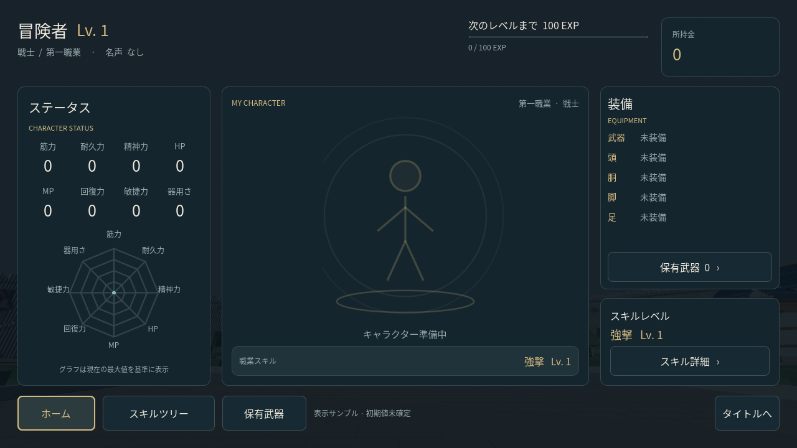

# スタート画面・ホーム UI

Godot 4.6.3向けの独立したUIです。F5でスタート画面を表示し、**START**でホームへ進みます。

- ホーム：名前、レベル、職業、名声、所持金、現在EXP、次レベルまでのEXP。
- ステータス：README準拠の8能力を4列×2行で表示。下の八角形グラフは、表示中の最大能力値を基準にした相対表示です。ゲーム上の上限ではありません。
- 中央：自分のキャラクター表示枠。モデル未接続の間は「キャラクター準備中」を表示。
- 装備：メイン武器、頭・胴・脚・足。未装備時と保有武器なしの状態にも対応。
- スキル：現在職業のスキル名とスキルレベル。
- スキルツリー：第一6職の名前・キャラクター表示枠をタップすると、対応武器、補正、スキル、第二職業への分岐を表示。職業の閲覧だけを行い、転職は実行しません。
- 詳細はスクロール可能。閉じる、領域外のタップ、Escで戻れます。ホーム・ツリー・タイトルの移動に対応します。

初期状態の「冒険者・戦士・Lv1・0EXP・所持金0・能力値0・強撃Lv1・未装備」は**表示確認用のサンプル**です。確定した初期値や保存データではありません。通貨名、スキルEXP曲線などの未決定ルールは追加していません。オンライン・保存・装備変更・戦闘との連携は本変更の対象外です。

## 画面例

[スタート画面](frontend-title.png) · [ホーム](frontend-home.png) · [スキルツリー](frontend-tree.png)



## 並行開発との境界

新規画面は `scenes/frontend/`、スクリプトは `scripts/frontend/`、表示用素材は `assets/frontend/` に分離しています。共有ファイルの変更は `project.godot` の起動シーン指定1行だけです。

既存の `scenes/main.tscn`、王都生成物、HUD、プレイヤー制御、既存フォントは変更していません。王都の確認は、Godotで `scenes/main.tscn` を開き **F6**、または次のように起動してください。

```sh
godot --path . res://scenes/main.tscn
```

既存の `tools/capture_preview.gd` と `tools/browser_smoke.py` は王都用です。画面の撮影には下記の専用ツールを使用します。起動シーンを参照する旧撮影ツールを王都用に使う場合は、別のチェックアウトで元の起動シーン設定を使用してください。

## キャラクターの接続

`scenes/frontend/start_home.tscn` のルートを選び、インスペクターで次を設定してください。

- `character_scene`：ホーム中央の自分のキャラクターのPackedScene。
- `first_job_scenes`：第一職業カード用のPackedScene辞書。キーは `warrior` / `mage` / `scout` / `archer` / `cleric` / `artisan`。

シーンのルートは `Node3D`、足元は原点、正面は+Z、身長は約2 Godot単位を想定します。既存モデルの寸法・向きが異なる場合は、表示専用のラッパーシーンで調整してください。ゲームのPlayer、入力処理、HUD、カメラを含めない表示用モデルを渡します。各表示枠は独立したSubViewportとWorld3Dを持ち、モデル同士や王都と干渉しません。

## プレイヤー情報の接続

画面の `set_profile(snapshot: Dictionary)` にプレイヤーの表示情報を渡せます。画面はデータを読み取り、ゲーム状態や保存ファイルを書き換えません。サンプルの構造は `scripts/frontend/home_data.gd` にあります。実データ連携時は全項目を渡してください。

```gdscript
frontend.set_profile({
    "username": "プレイヤー名", "level": 12, "job_id": "warrior",
    "exp": 340, "gold": 12345, "fame": "なし",
    "stats": {"筋力": 15, "耐久力": 23, "精神力": 31, "HP": 405,
              "MP": 63, "回復力": 17, "敏捷力": 28, "器用さ": 39},
    "skills": {"strong_strike": 4},
    "equipment": {"head": "兜", "body": "", "legs": "", "feet": ""},
    "owned_weapons": [{"name": "剣", "type": "剣", "rank": "コモン",
                       "equipped": true, "description": "武器の説明"}]
})
```

この例の「次のレベルまで」は `12 × 100 − 340 = 860 EXP` です。`exp` は累計でなく、現在レベル内の獲得EXPです。武器の `equipped` が真の項目をホームのメイン武器に表示します。第一職業とスキルIDは `home_data.gd` の対応を参照してください。複数武器の同時装備や装備変更はUIでは行いません。

## 確認・撮影

```sh
godot --headless --path . --editor --import --quit
godot --headless --path . --script res://tools/test_frontend.gd
# 描画可能なディスプレイ上で実行（headlessでは撮影不可）
godot --path . --audio-driver Dummy --script res://tools/capture_frontend.gd -- --page=home --output=/tmp/pvp-home.png
```

テストはSTART遷移、第一6職の詳細と第二12職、武器なし・保有武器あり、8能力、EXP・所持金、サンプルからの情報差し替え、ナビゲーションの表示範囲、モデル表示枠の独立性を確認します。実機での可読性や性能は未測定です。

新しい画面は既存HUDと別の日本語フォントを使います。文字を追加した場合のみ、Noto Sans CJKと任意の開発依存 `fonttools` を使って再生成できます。ゲームの実行には不要です。

```sh
python3 tools/subset_frontend_font.py --font /path/to/NotoSansCJK-Regular.ttc
```
