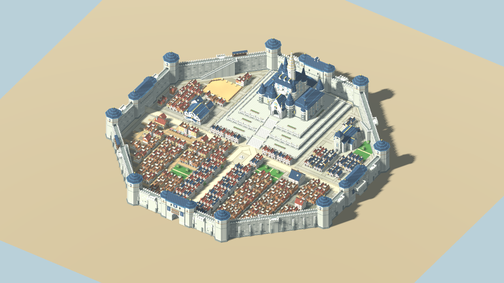
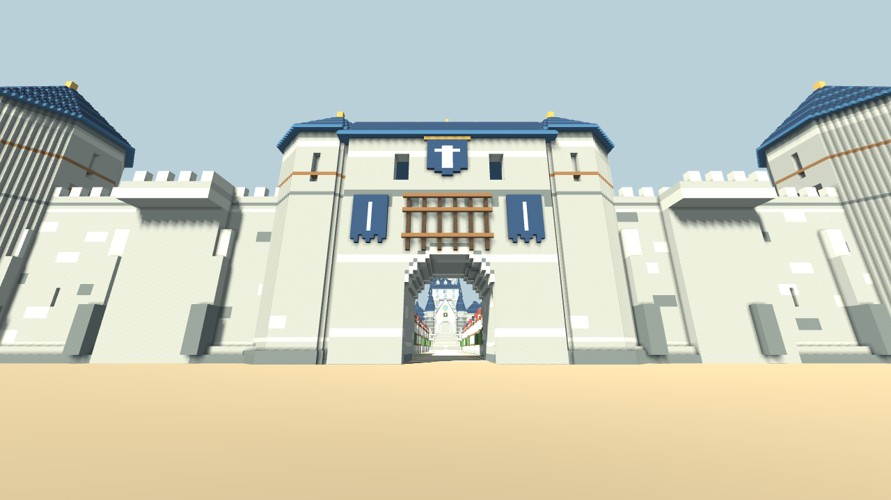
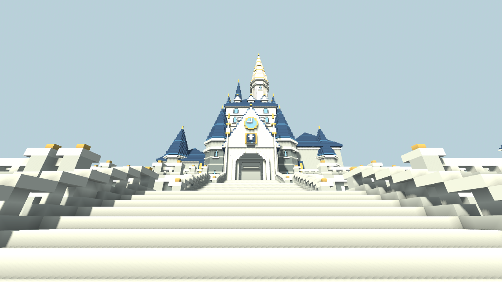
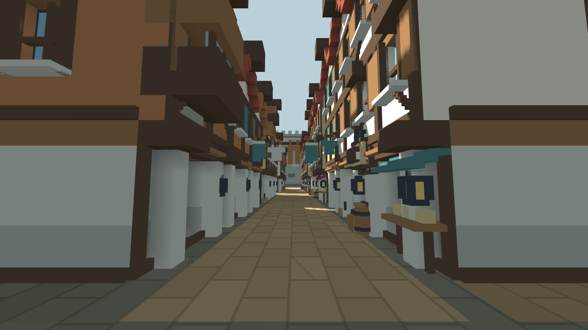
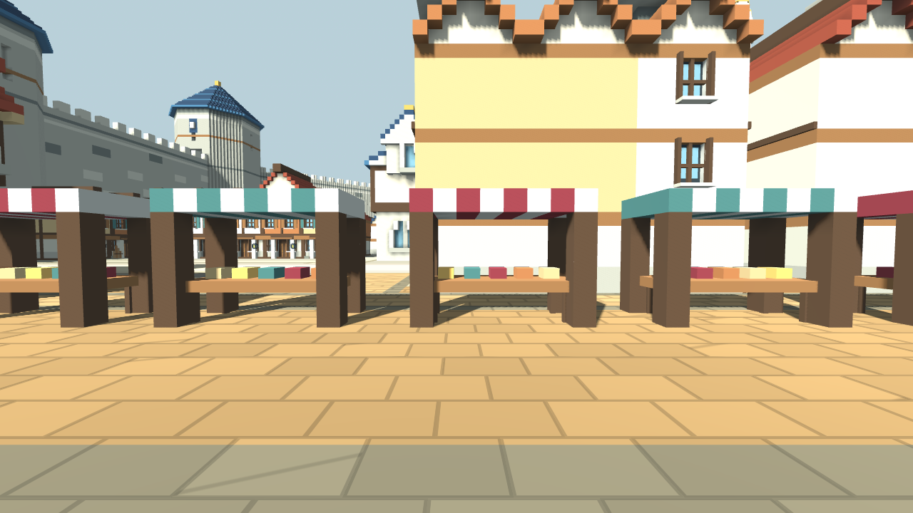
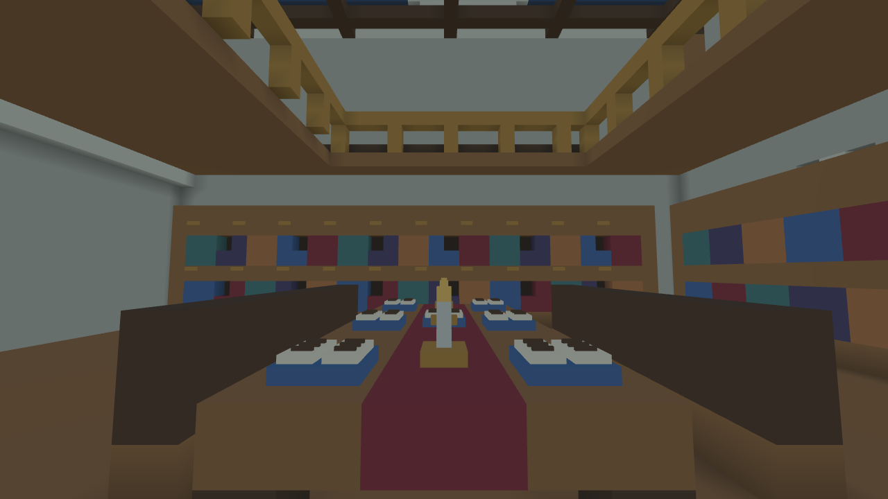

# 王都セレシアのボクセル3Dプレビュー

更新日：2026-10-27。無料の Godot 4.6.3 で開ける、スマートフォン横画面を想定した一人称の王都試作です。城壁・三段のテラスに載る王城・連棟の城下町を含む `town` 段階の生成済みシーンを同梱しています。オンラインPvP、会話や行動を持つNPC、職業や成長の仕組みは今後の実装対象です。

## 造形と制作範囲

建築は共通の 0.5 m グリッドで作り、細い看板・紐・食器などを小さな立体部品で補っています。北側に王城と大階段、中央に大通りと広場、その周囲に公共施設と連棟の街区を置く構成です。実在建築と公式写真の観察は [建築参考資料](architecture-references.md) に記録しています。

| 場所 | 内容 |
| --- | --- |
| 王都の外周 | 幅 320 m の正八角形。壁厚 7 m、歩廊の高さ 24 m、有効幅 5 m。 |
| 城壁の設備 | 角塔 8、東西南北の門 4、門脇の塔 8、射撃台 12、内側の階段 4、覆い付きの張り出し防御回廊 3。歩廊と塔・門楼を移動できる。 |
| 王城 | 東京ディズニーランドのシンデレラ城の縦長の輪郭を主な参考にした独自設計。最高点 106 m。低い前門、急勾配の屋根、段違いの中塔、細い主塔を重ねる。従来の城全体と内装をそのまま 12 m 持ち上げた。 |
| 王城のテラス | 高さ 6・10・14 m の三段。中央の大階段は下から幅 18・16・14 m、蹴上げ 0.5 m、踏面 1.5 m。踊り場、石の欄干、控え壁、壁面のアーチ状のくぼみ、縁取りと植栽を備え、上段から高さ 15 m の既存入口へつながる。 |
| 王城内部 | 前庭を含む用途の異なる 21 の空間。城内の床の高さは 15・21・27・33・39・45 m。大階段、玉座の間、回廊、図書室、食堂、厨房、評議室、執務室、寝室、衛兵の部屋などを配置。 |
| 王城の細部 | 図書室の書籍と文具、食堂の皿と杯、厨房の炉、寝台のカーテンなど、部屋の用途に合わせた小物。 |
| 城下町 | 住宅・小店舗など 517 棟と、大型の冒険者ギルド・酒場・教会の 3 棟。うち 507 棟が隣家に接する連棟で、162 の連棟群を作る。市場、鍛冶屋、訓練場、公園を配置。街で入れる住宅・公共施設は計 11 か所。 |
| 街路 | 96 本の街路。大通りの揃った家並み、路地に面した連棟、幅 2 m の裏路地を八角形の城壁の内側に収める。103 の街区列に建物を置き、84 棟の目立つ正面に細部を集中する。 |
| 街の暮らし | 屋台 12 台、店先の庇 12、荷車 4、職業看板 24、商品台 7、作業棚 4、荷物の山 2。洗濯物や旗、樽、使い込まれた壁面を加えた。8 体の棒人間は小物と一緒にメッシュへまとめた静止した造形で、会話や自律移動の処理は持たない。 |

街区ごとに地面の色と材質を変えています。大通りは明るい石と帯状の模様、西の古街区は暖色の石畳、南東の質素な街区は擦れた舗装と湿った箇所、土の縁、錆や苔の色を使います。公園の区画は緑の芝地で満たし、園路を通しています。訓練場は金色の砂地です。

歩行用の基礎地面の上端は Y=2 m、地区ごとの見える面は Y=2.03 m です。道路・街区・公園を切り分けた面で城内を覆うため、同じ場所へ床板を重ねません。目地や地面の模様は Shader で表します。共通の基礎は城外用の 12 三角形・1 メッシュと地面全体を支える 1 個の BoxCollider、城内の地区別地面は 81,852 三角形・20 メッシュです。王城にはテラスと城内の専用床があります。

城外を含む約 640 m 四方の地面は平らです。城外は山岳・海・砂漠・草・岩を配置していない更地です。周辺地形の将来案は README のゲーム構想に残しています。

## プレビュー画像













## 起動と操作

Godot 4.6.3 でリポジトリの `project.godot` をインポートし、**F5** でメインシーンを実行します。追加ライブラリや Blender は起動に不要です。

| 操作 | PC | タッチ端末 |
| --- | --- | --- |
| 移動 | WASD / 矢印キー | 左のスティック |
| 視点 | 画面クリック後にマウス | 右側の空白をドラッグ |
| 走る | Shift | — |
| 跳ぶ | Space | ジャンプボタン |
| 見学場所を順に切り替える | N | 右上の「見学先」ボタン |
| 全体図と歩行を切り替える | M | 右上の「全体図」ボタン |
| マウスを解除する | Esc | — |
| 仮の開始位置へ戻る | R | — |
| 開発用の統計表示 | F3 | — |

0.5 m 程度の段差は歩いて登れます。全 15 か所の見学先を切り替えて王城前、広間、図書室、街の施設などへ移動でき、全体図から建物と道の配置を確認できます。

## 軽量化と計測

- ボクセル一個ずつに Node や Cube を作らず、外へ露出する面だけを生成する。
- 同色・同方向・同じ陰影条件の隣接面を結合する greedy mesher を使い、局所的な陰影は頂点色へ焼き込む。
- 建築を 32 m ごとの空間区画へ分ける。各生成成分は頂点色のパレット材質を一つ使い、画面外の区画を描画対象から外す。
- 形状と衝突判定を制作時に生成し、圧縮済みシーンへ保存する。`generated/kingdom.scn` と `generated/parts/` に分割し、実行時に全ボクセルを作り直さない。
- 王城内部は階や部屋の成分へ分け、城の近くで現在地に近い階を表示する。内装はリアルタイムの影を落とさない。
- 細い小物は CPU で作った ArrayMesh にまとめ、表示距離を 90 m に制限する。小物には影と衝突判定を付けない。
- 連棟は接する側の壁を共有し、目立つ通りの正面へ細部を集中する。背面や裏路地側は形状を抑える。
- 少数の静止した棒人間も小物のメッシュへまとめ、人物ごとの Node や行動処理を追加しない。
- 地区別の地面と石畳の目地は追加のブロックや画像テクスチャを使わず描画する。追加購入のモデルや素材には依存しない。

`town` 段階の保存済み形状は次のとおりです。内訳は [generated/world_metrics.json](../generated/world_metrics.json) から集計しています。

| 成分 | 保存済み三角形数 | 補足 |
| --- | ---: | --- |
| 城壁・塔・門楼 | 345,500 | 116 区画 |
| 王城外観・テラス | 223,396 | 36 区画 |
| 王城内部 | 34,128 | 6 成分・53 区画 |
| 王城の細かい小物 | 40,152 | 5 成分・3,346 個の小ブロックを 26 区画へ集約 |
| 城下町の建築・設備 | 617,072 | 69 区画。屋台の屋根・支柱や店先の庇を含む |
| 街の細かい小物 | 526,980 | 43,915 個の小ブロックを 64 区画へ集約。静止した棒人間を含む |
| 城内の地区別地面 | 81,852 | 20 メッシュ |
| 城外の地面・共通の衝突基礎 | 12 | 1 メッシュ・1 個の BoxCollider |

住宅・小店舗などの屋根の平面面積は計 **17,268.5 m²** です。圧縮済みシーンは 20 個の分割成分と親シーンを合わせて **23,521,154 bytes（約 22.43 MiB）** です。JSON の `total_scene_bytes` に相当します。上表の三角形数は合計 **1,869,092** で、保存している全形状の量です。毎フレーム描画する量は、視野、距離、王城の階の表示切り替えによって変わります。draw calls は影の描画パスの影響も受けるため、F3 または撮影ツールの出力で視点ごとに確認します。

スマートフォン実機の FPS・メモリ使用量は未測定です。ブラウザのモバイル画面エミュレーションや制作環境の描画数とは区別します。

## 造形を変更する場所

| ファイル | 内容 |
| --- | --- |
| [walls.gd](../scripts/voxel/walls.gd) | 城壁、角塔、門楼、歩廊、階段、射撃設備 |
| [palace.gd](../scripts/voxel/palace.gd) | 王城の外観、部屋、床、階段、移動経路と高さの変更 |
| [palace_terraces.gd](../scripts/voxel/palace_terraces.gd) | 三段のテラス、大階段、欄干、擁壁と植栽 |
| [palace_details.gd](../scripts/voxel/palace_details.gd) | 王城の部屋ごとの細かい家具・小物 |
| [town.gd](../scripts/voxel/town.gd) | 街区、連棟、道、公共施設、公園と地面の領域 |
| [house_builder.gd](../scripts/voxel/house_builder.gd) | 住宅、共有壁、正面の装飾、風化表現と一部の入れる部屋 |
| [civic_buildings.gd](../scripts/voxel/civic_buildings.gd) | ギルド、酒場、教会の建築と一階内部 |
| [street_life.gd](../scripts/voxel/street_life.gd) | 店先の庇、荷車、看板、商品、静止した棒人間 |
| [detail_builder.gd](../scripts/voxel/detail_builder.gd) | 紐、洗濯物、旗、看板、樽などの小物 |
| [district_surfaces.gd](../scripts/voxel/district_surfaces.gd) | 地区別の舗装、公園、訓練場と面の切り分け |
| [terrain.gd](../scripts/voxel/terrain.gd) | 城外の平らな地面と共通の衝突基礎 |
| [volume.gd](../scripts/voxel/volume.gd) / [mesher.gd](../scripts/voxel/mesher.gd) | 制作時のボクセル配置、面の結合、陰影 |
| [factory.gd](../scripts/voxel/factory.gd) / [world.gd](../scripts/voxel/world.gd) | 成分の組み立て、地区別地面への切り替え、見学先と表示管理 |
| [voxel_preview.gd](../scripts/voxel_preview.gd) | 生成済みシーンの読み込み、光と空 |
| [player_controller.gd](../scripts/player_controller.gd) / [hud.gd](../scripts/hud.gd) | 一人称移動、タッチ操作、全体図、見学 UI |

通常の見学には同梱の生成済みシーンを使うため、再生成は不要です。造形コードを変更した場合は、リポジトリのルートで制作段階を明示して再生成します。

```sh
godot --headless --path . --script res://tools/bake_voxel_world.gd -- --stage=town
```

`--stage=walls` は地面と城壁、`--stage=palace` は王城まで、`--stage=town` は城下町を含む段階です。再生成後に F5 で開き直してください。

## 検証

生成済みシーンに対し、共通形状と操作、城壁の構成、王城の部屋・階段・経路、街の入口・通路を分けて検証します。物理移動の再現性を保つため `--fixed-fps 60` を付けます。

```sh
godot --headless --path . --fixed-fps 60 --script res://tools/test_voxel_world.gd
godot --headless --path . --fixed-fps 60 --script res://tools/test_fortress.gd
godot --headless --path . --fixed-fps 60 --script res://tools/test_palace_routes.gd
godot --headless --path . --fixed-fps 60 --script res://tools/test_town_routes.gd
```

最終の `town` シーンで、共通操作 81 項目、城壁 25 項目、王城 118 項目、城下町 125 項目がすべて合格しました。王城の全14経路には地上から三段のテラス・城の入口までの大階段を含みます。北門と王城裏の通り、各街路、入室できる施設も実際のプレイヤーの衝突判定で歩いて確認しています。

Web 版を配信した状態で、[browser_smoke.py](../tools/browser_smoke.py) により Chromium のデスクトップ画面とモバイル横画面を確認できます。Python の Playwright、Pillow、Chromium が必要です。

```sh
python3 tools/browser_smoke.py --url http://127.0.0.1:8080/ --output captures
```

起動、実際の 3D 描画、移動、全体図、N キーまたはタッチによる見学先の切り替え、致命的な JavaScript / GDScript エラーを検査します。街や王城を歩き通す検証は Godot 側の経路テストで行います。モバイル画面のエミュレーションは実機の速度測定ではありません。

最終版は Chromium の PC 1280×720 とモバイル横 844×390 の両方で合格しました。前進、全体図から歩行への復帰、見学先の2回の切り替えを確認し、JavaScript・GDScript・コンソールのエラーは0件です。モバイルはタッチイベント、PCは実座標へのマウス入力で操作を送り、実際の描画の変化を検証しています。[Web検証結果](web-smoke-results.json)。

## スクリーンショット

実際に画面を描画できる環境で実行します。撮影には `--headless` を付けません。

```sh
godot --path . --audio-driver Dummy --script res://tools/capture_preview.gd -- --overview --hide-hud --output=/tmp/voxel-overview.png
godot --path . --audio-driver Dummy --script res://tools/capture_preview.gd -- --tour=palace_front --hide-hud --output=/tmp/voxel-castle.png
godot --path . --audio-driver Dummy --script res://tools/capture_preview.gd -- --tour=palace_library --hide-hud --output=/tmp/voxel-library.png
```

`--position=x,y,z`、`--yaw=角度`、`--pitch=角度` で歩行視点を指定できます。俯瞰の構図は `--camera-position=x,y,z`、`--camera-target=x,y,z`、`--overview-size=幅` で調整できます。

## ブラウザ版の作成

Godot 4.6.3 と同じバージョンの Web export template を導入し、リポジトリのルートで実行します。

```sh
mkdir -p build/web
godot --headless --path . --export-release Web build/web/index.html
python3 tools/serve_preview.py --directory build/web --port 8080
```

`http://127.0.0.1:8080/` を開きます。HTML の直接ダブルクリックではなく HTTP で配信してください。同じ LAN の端末から試す場合は、配信コマンドに `--bind 0.0.0.0` を加え、PC の LAN アドレスとポートへアクセスします。

[download_web_templates.py](../tools/download_web_templates.py) は公式テンプレートの Web 部分だけを取得する補助ツールです。対象の Godot バージョンを確認して使用してください。

## 外部3Dツール向けの書き出し

```sh
godot --path . --audio-driver Dummy --script res://tools/export_model.gd -- --output=res://build/selesia.glb
```

GLB 書き出しにも実描画できる環境が必要です。出力は形状確認・外部編集向けで、衝突判定、カメラ、HUD、ゲームの処理は含みません。Godot 固有の地面 Shader の目地や模様は GLB では単色の材質へ置き換わります。GLB を編集しても生成コードへ自動反映されません。

## 使用素材

建築、地面、小物の形状と配色はプロジェクト内で生成しています。追加の素材購入は不要です。外部の参考写真や既存作品のモデルは転載していません。

UI フォントは OFL の Noto Sans CJK を必要文字に絞ったものです。ライセンスは [NOTO-LICENSE.txt](../assets/fonts/NOTO-LICENSE.txt) を参照してください。
