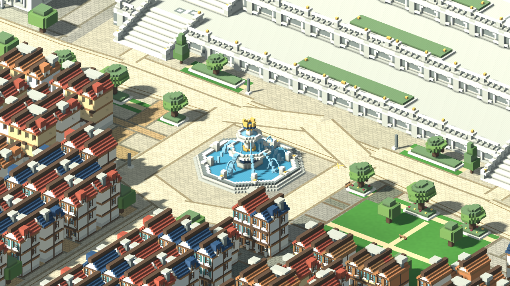
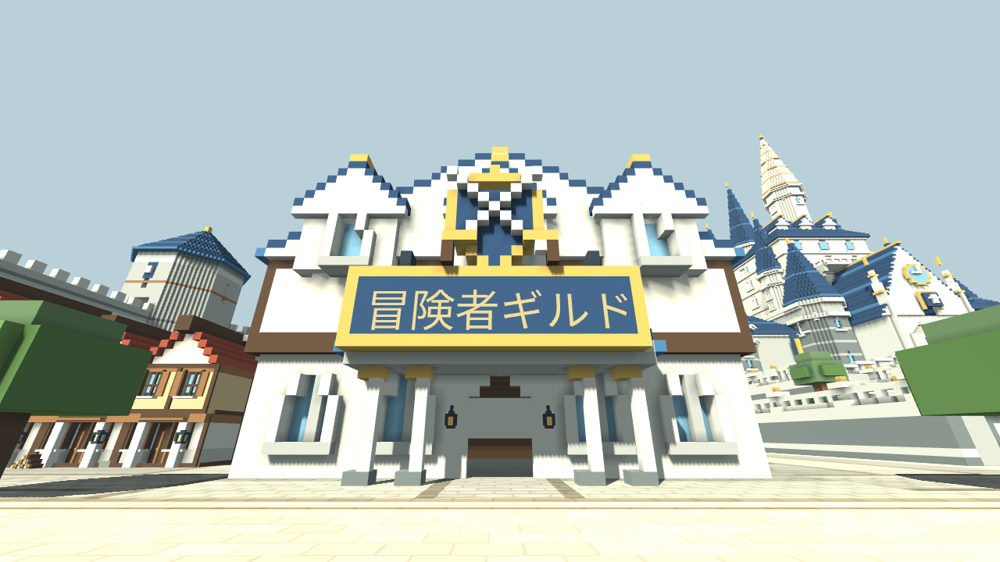
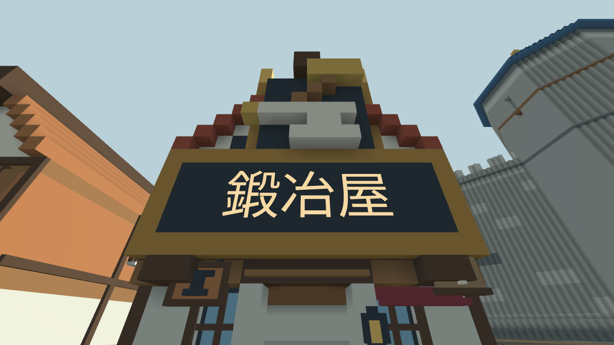

# 王都セレシアのボクセル3Dプレビュー

更新日：2026-10-28。無料の Godot 4.6.3 で開ける、スマートフォン横画面を想定した一人称の王都見学プレビューです。城壁・三段のテラスに載る王城・連棟の城下町を含む `town` 段階の生成済みシーンを同梱しています。ホームから参加する時間無制限PvPと今回の成長処理は [対戦と成長](battle.md) を参照してください。この文書では地形の制作・見学・検証を説明します。

## 造形と制作範囲

建築は共通の 0.5 m グリッドで作り、細い看板・紐・食器などを小さな立体部品で補っています。北側に三段のテラスに載る王城、中央に大噴水と庭園、その周囲に用途でまとまった施設群と連棟の街区を置く構成です。実在建築と公式写真の観察は [建築参考資料](architecture-references.md) に記録しています。

| 場所 | 内容 |
| --- | --- |
| 王都の外周 | 幅 320 m の正八角形。壁厚 7 m、歩廊の高さ 24 m、有効幅 5 m。 |
| 城壁の設備 | 角塔 8、東西南北の門 4、門脇の塔 8、射撃台 12、内側の階段 4、覆い付きの張り出し防御回廊 3。歩廊と塔・門楼を移動できる。 |
| 王城 | 東京ディズニーランドのシンデレラ城の縦長の輪郭を主な参考にした独自設計。最高点 106 m。低い前門、急勾配の屋根、段違いの中塔、細い主塔を重ねる。従来の城全体と内装をそのまま 12 m 持ち上げた。 |
| 王城のテラス | 高さ 6・10・14 m の三段。幅 12 m、蹴上げ 0.5 m の階段を左右から回り込み、上段は左右の外側から中央へ向かう長さ 24 m の階段で、高さ 10 m から 14 m へ上がる。下二段の踏面は 1.5 m、上段は 3 m。上がり切った内側の広い踊り場から植栽の後ろを通って城の入口へ歩ける。中央は低い植栽と連続する石の欄干とし、踊り場、控え壁、壁面のアーチ状のくぼみを備える。上段から高さ 15 m の既存入口へつながる。 |
| 王城内部 | 前庭を含む用途の異なる 21 の空間。城内の床の高さは 15・21・27・33・39・45 m。大階段、玉座の間、回廊、図書室、食堂、厨房、評議室、執務室、寝室、衛兵の部屋などを配置。 |
| 王城の細部 | 図書室の書籍と文具、食堂の皿と杯、厨房の炉、寝台のカーテンなど、部屋の用途に合わせた小物。 |
| 城下町 | 住宅・小店舗など 428 棟と、大型の冒険者ギルド・酒場・教会の 3 棟。416 棟が隣家に接し、134 の連棟群を作る。南側の住宅密度を保ち、王城前は庭園と広場として空ける。街で入れる住宅・公共施設は計 11 か所。 |
| 街路 | 大通りの揃った家並み、路地に面した連棟、幅 2 m の裏路地を八角形の城壁の内側に収める。東西の大通りは噴水の北側を通り、左右の階段へ向かう通路を確保する。街路は 98 本、建物を置いた街区列は 86、細部を集中した正面は 64 棟。 |
| 街の暮らし | 屋台、庇、荷車、職業看板、商品台、作業棚、洗濯物や旗、樽、使い込まれた壁面を加えた。8 体の棒人間は小物と一緒にメッシュへまとめた静止した造形で、会話や自律移動の処理は持たない。屋台 12 台、店先の庇 12、荷車 3、職業看板 24、商品台 5、作業棚 2、荷物の山 2。 |
| 王冠の大噴水 | 直径 23 m、三段の水盤と青と金の王冠を持つ王都の中心。青い水面、噴流、流れ落ちる水をボクセルの静止した造形で表す。周囲の広場を歩いて回れる。 |
| 王城前の庭園 | 住宅のない広い緩衝帯に、左右対称の花壇、低木、樹木、ベンチを配置。中央から王城を見通せるようにし、左右の階段の足元と横断する道を空ける。 |
| 施設の看板 | 冒険者ギルド、鍛冶屋、武器店、酒場、薬屋、宿屋、市庁舎、教会の 8 施設。読める日本語の施設名と、交差した剣・金槌と金床などの絵柄を建物に取り付けた立体の看板にする。 |

西側は訓練場と兵舎からギルドの木陰の広場へつながり、その南に酒場と市場を置いています。工房街では武器店が通りの向かいの鍛冶屋、防具工房、木工工房に向き合います。東側は教会と薬屋の間に薬草園・薬用植物の庭を設け、市庁舎、宿屋、働く人のための公園へ続きます。施設の用途と隣り合う場所に意味を持たせています。店や工房は建物と入室のための試作で、売買・製作・治療・クエストの処理は今後の実装対象です。

街区ごとに地面の色と材質を変えています。大通りは明るい石と帯状の模様、西の古街区は暖色の石畳、南東の質素な街区は擦れた舗装と湿った箇所、土の縁、錆や苔の色を使います。城下町には公園・庭園が計 11 区画、樹木が 39 本あります。公園の区画は緑の芝地で満たし、園路を通しています。訓練場は金色の砂地です。

歩行用の基礎地面の上端は Y=2 m、地区ごとの見える面は Y=2.03 m です。道路・街区・公園を切り分けた面で城内を覆うため、同じ場所へ床板を重ねません。目地や地面の模様は Shader で表します。城外の地面は 12 三角形・1 メッシュ、地面全体の衝突基礎は 1 個の BoxCollider です。城内の地区別地面は 83,074 三角形・20 メッシュです。王城にはテラスと城内の専用床があります。

城外を含む約 640 m 四方の地面は平らです。城外は山岳・海・砂漠・草・岩を配置していない更地です。周辺地形の将来案は README のゲーム構想に残しています。

## プレビュー画像









## 起動と操作

Godot 4.6.3 でリポジトリの `project.godot` をインポートし、`scenes/main.tscn` を開いて **F6** で王都の見学シーンを実行します。F5はスタート・ホーム画面です。追加ライブラリや Blender は起動に不要です。

| 操作 | PC | タッチ端末 |
| --- | --- | --- |
| 移動 | WASD / 矢印キー | 左のスティック |
| 視点 | 画面クリック後にマウス | 右側の空白をドラッグ |
| 走る | Shift | — |
| 跳ぶ | Space | ジャンプボタン |
| 見学場所を順に切り替える | N | 右上の「見学先」ボタン |
| 全体図と歩行を切り替える | M | 右上の「全体図」ボタン |
| マウスを解除する | Esc | — |
| 仮の開始位置へ戻る | R | — |
| 開発用の統計表示 | F3 | — |

0.5 m 程度の段差は歩いて登れます。全 18 か所の見学先を切り替えて王城前、広間、図書室、街の施設などへ移動でき、全体図から建物と道の配置を確認できます。

## 軽量化と計測

- ボクセル一個ずつに Node や Cube を作らず、外へ露出する面だけを生成する。
- 同色・同方向・同じ陰影条件の隣接面を結合する greedy mesher を使い、局所的な陰影は頂点色へ焼き込む。
- 建築を 32 m ごとの空間区画へ分ける。ボクセルの各生成成分は頂点色のパレット材質を一つ使い、画面外の区画を描画対象から外す。
- 形状と衝突判定を制作時に生成し、圧縮済みシーンへ保存する。`generated/kingdom.scn` と `generated/parts/` に分割し、実行時に全ボクセルを作り直さない。
- 王城内部は階や部屋の成分へ分け、城の近くで現在地に近い階を表示する。内装はリアルタイムの影を落とさない。
- 細い小物は CPU で作った ArrayMesh にまとめ、表示距離を 90 m に制限する。小物には影と衝突判定を付けない。
- 連棟は接する側の壁を共有し、目立つ通りの正面へ細部を集中する。背面や裏路地側は形状を抑える。
- 少数の静止した棒人間も小物のメッシュへまとめ、人物ごとの Node や行動処理を追加しない。
- 施設名の文字は制作時に ArrayMesh へ焼き込み、固定した看板の形状として保存する。
- 地区別の地面と石畳の目地は追加のブロックや画像テクスチャを使わず描画する。追加購入のモデルや素材には依存しない。

`town` 段階の保存済み形状は次のとおりです。内訳は [generated/world_metrics.json](../generated/world_metrics.json) から集計しています。

| 成分 | 保存済み三角形数 | 補足 |
| --- | ---: | --- |
| 城壁・塔・門楼 | 345,500 | 116 区画 |
| 王城外観・テラス | 224,192 | 36 区画 |
| 王城内部 | 34,128 | 6 成分・53 区画 |
| 王城の細かい小物 | 40,152 | 5 成分・3,346 個の小ブロックを 26 区画へ集約 |
| 城下町の建築・設備 | 528,400 | 67 区画。噴水、屋台、庇、施設の看板本体を含む |
| 街の細かい小物 | 433,116 | 36,093 個の小ブロックを 62 区画へ集約。静止した棒人間を含む |
| 施設名の文字 | 2,410 | 8 施設分。`town_details.sign_text_triangles` |
| 城内の地区別地面 | 83,074 | 20 メッシュ |
| 城外の地面・共通の衝突基礎 | 12 | 1 メッシュ・1 個の BoxCollider |

施設名の文字は JSON の `sign_text_triangles` を別成分として加算しています。上表の保存済み形状は合計 **1,690,984** 三角形です。

住宅・小店舗などの屋根の平面面積は計 **14,402.5 m²**。圧縮済みシーンは **20 個の分割成分と親シーンを合わせて 21,546,204 bytes（約 20.55 MiB）** です。保存サイズは JSON の `total_scene_bytes` に相当します。

保存する全形状の量と、毎フレーム描画する量は異なります。描画量は視野、距離、王城の階の表示切り替えによって変わります。draw calls は影の描画パスの影響も受けるため、F3 または撮影ツールの出力で視点ごとに確認します。

スマートフォン実機の FPS・メモリ使用量は未測定です。ブラウザのモバイル画面エミュレーションや制作環境の描画数とは区別します。

## 造形を変更する場所

| ファイル | 内容 |
| --- | --- |
| [walls.gd](../scripts/voxel/walls.gd) | 城壁、角塔、門楼、歩廊、階段、射撃設備 |
| [palace.gd](../scripts/voxel/palace.gd) | 王城の外観、部屋、床、階段、移動経路と高さの変更 |
| [palace_terraces.gd](../scripts/voxel/palace_terraces.gd) | 三段のテラス、左右の回り階段、欄干、擁壁と植栽 |
| [palace_details.gd](../scripts/voxel/palace_details.gd) | 王城の部屋ごとの細かい家具・小物 |
| [town.gd](../scripts/voxel/town.gd) | 街区、連棟、道、公共施設、公園と地面の領域 |
| [house_builder.gd](../scripts/voxel/house_builder.gd) | 住宅、共有壁、正面の装飾、風化表現と一部の入れる部屋 |
| [civic_buildings.gd](../scripts/voxel/civic_buildings.gd) | ギルド、酒場、教会の建築と一階内部 |
| [royal_gardens.gd](../scripts/voxel/royal_gardens.gd) | 王城前の庭園と大噴水、花壇、樹木、ベンチ |
| [facility_signs.gd](../scripts/voxel/facility_signs.gd) | 施設名と絵柄を建物に取り付けた 8 施設の看板 |
| [street_life.gd](../scripts/voxel/street_life.gd) | 店先の庇、荷車、看板、商品、静止した棒人間 |
| [detail_builder.gd](../scripts/voxel/detail_builder.gd) | 紐、洗濯物、旗、看板、樽などの小物 |
| [district_surfaces.gd](../scripts/voxel/district_surfaces.gd) | 地区別の舗装、公園、訓練場と面の切り分け |
| [terrain.gd](../scripts/voxel/terrain.gd) | 城外の平らな地面と共通の衝突基礎 |
| [volume.gd](../scripts/voxel/volume.gd) / [mesher.gd](../scripts/voxel/mesher.gd) | 制作時のボクセル配置、面の結合、陰影 |
| [factory.gd](../scripts/voxel/factory.gd) / [world.gd](../scripts/voxel/world.gd) | 成分の組み立て、地区別地面への切り替え、見学先と表示管理 |
| [voxel_preview.gd](../scripts/voxel_preview.gd) | 生成済みシーンの読み込み、光と空 |
| [player_controller.gd](../scripts/player_controller.gd) / [hud.gd](../scripts/hud.gd) | 一人称移動、タッチ操作、全体図、見学 UI |
| [test_city_design.gd](../tools/test_city_design.gd) | 左右の階段、庭園と噴水、施設の配置と看板を生成済みの形状・物理で検証 |

通常の見学には同梱の生成済みシーンを使うため、再生成は不要です。造形コードを変更した場合は、リポジトリのルートで制作段階を明示して再生成します。

```sh
godot --headless --path . --script res://tools/bake_voxel_world.gd -- --stage=town
```

`--stage=walls` は地面と城壁、`--stage=palace` は王城まで、`--stage=town` は城下町を含む段階です。再生成後に F5 で開き直してください。

## 検証

生成済みシーンに対し、共通形状と操作、城壁の構成、王城の部屋・階段・経路、街の入口・通路、庭園・噴水・施設の看板を分けて検証します。物理移動の再現性を保つため `--fixed-fps 60` を付けます。

```sh
godot --headless --path . --fixed-fps 60 --script res://tools/test_voxel_world.gd
godot --headless --path . --fixed-fps 60 --script res://tools/test_fortress.gd
godot --headless --path . --fixed-fps 60 --script res://tools/test_palace_routes.gd
godot --headless --path . --fixed-fps 60 --script res://tools/test_town_routes.gd
godot --headless --path . --fixed-fps 60 --script res://tools/test_city_design.gd
```

最終の `town` シーンで、次の 5 本、計 **515 項目** がすべて合格しました。

| 検証 | 結果 |
| --- | --- |
| 共通形状・操作 | 93 項目 PASS |
| 城壁・塔・門・射撃設備 | 25 項目 PASS |
| 王城の部屋・階段・歩行 | 122 項目 PASS。全 15 経路を歩行し、左右の回り階段は復路も歩行 |
| 街路・施設入口・公共施設内部 | 128 項目 PASS。噴水の周回路を含む全 114 経路を歩行 |
| 庭園・施設配置・噴水・看板 | 147 項目 PASS。上段の実際の床が中央へ向かって高くなること、踊り場から入口までの通行、緑地と住宅、噴水の縁、ギルドと鍛冶屋の看板・文字・見通しを確認 |

左右の階段は地上から内側の踊り場を経て城の入口へ到達でき、城から地上へ戻れることを、生成済みシーンのプレイヤーと衝突判定で確認しています。北門と王城裏の通り、各街路と公共施設の入口も検証対象です。

王都を単独で起動したWebビルドは、ChromiumのPC 1280×720とモバイル横844×390で検証済みです。428棟・王城21空間・18か所の見学先を読み込み、移動、全体図から歩行への復帰、見学先の切り替え、タッチ入力を確認しました。[王都単独Web検証の記録](web-smoke-results.json)。`tools/browser_smoke.py` はこの見学専用ビルド向けの補助ツールです。

現在の標準Web書き出しはホームから対戦へ進みます。その通信・帰還・ポイント配分の検証は [対戦と成長](battle.md#実装と検証) を参照してください。モバイル画面のエミュレーションはスマートフォン実機の速度測定とは区別しています。

## スクリーンショット

実際に画面を描画できる環境で実行します。撮影には `--headless` を付けません。

```sh
godot --path . --audio-driver Dummy --script res://tools/capture_preview.gd -- --overview --hide-hud --output=/tmp/voxel-overview.png
godot --path . --audio-driver Dummy --script res://tools/capture_preview.gd -- --tour=palace_front --hide-hud --output=/tmp/voxel-castle.png
godot --path . --audio-driver Dummy --script res://tools/capture_preview.gd -- --tour=palace_library --hide-hud --output=/tmp/voxel-library.png
godot --path . --audio-driver Dummy --script res://tools/capture_preview.gd -- --tour=royal_fountain --hide-hud --output=/tmp/voxel-fountain.png
godot --path . --audio-driver Dummy --script res://tools/capture_preview.gd -- --tour=guild_sign --hide-hud --output=/tmp/voxel-guild.png
godot --path . --audio-driver Dummy --script res://tools/capture_preview.gd -- --tour=blacksmith_sign --hide-hud --output=/tmp/voxel-blacksmith.png
```

`--position=x,y,z`、`--yaw=角度`、`--pitch=角度` で歩行視点を指定できます。俯瞰の構図は `--camera-position=x,y,z`、`--camera-target=x,y,z`、`--overview-size=幅` で調整できます。

## ブラウザ版の作成

標準のWeb書き出しはスタート・ホーム・対戦画面を起動します。Godot 4.6.3と同じバージョンのWeb export templateを導入し、リポジトリのルートで実行します。対戦サーバーの起動と接続先の設定は [対戦と成長](battle.md#ブラウザ版) を参照してください。

```sh
mkdir -p build/web
godot --headless --path . --export-release Web build/web/index.html
python3 tools/serve_preview.py --directory build/web --port 8080
```

`http://127.0.0.1:8080/` を開きます。HTML の直接ダブルクリックではなく HTTP で配信してください。同じ LAN の端末から試す場合は、配信コマンドに `--bind 0.0.0.0` を加え、PC の LAN アドレスとポートへアクセスします。

[download_web_templates.py](../tools/download_web_templates.py) は公式テンプレートの Web 部分だけを取得する補助ツールです。対象の Godot バージョンを確認して使用してください。

## 外部3Dツール向けの書き出し

```sh
godot --path . --audio-driver Dummy --script res://tools/export_model.gd -- --output=res://build/selesia.glb
```

GLB 書き出しにも実描画できる環境が必要です。出力は形状確認・外部編集向けで、衝突判定、カメラ、HUD、ゲームの処理は含みません。Godot 固有の地面 Shader の目地や模様は GLB では単色の材質へ置き換わります。GLB を編集しても生成コードへ自動反映されません。

## 使用素材

建築、地面、小物の形状と配色はプロジェクト内で生成しています。追加の素材購入は不要です。外部の参考写真や既存作品のモデルは転載していません。

UI フォントは OFL の Noto Sans CJK を必要文字に絞ったものです。ライセンスは [NOTO-LICENSE.txt](../assets/fonts/NOTO-LICENSE.txt) を参照してください。
